# CivicCare — UI/UX Case Study

A mobile app redesign where city residents report local problems (broken roads, waterlogging, garbage, dead streetlights) and track them until they're fixed, while the city office manages every report from one console.

**[▶ Open the live prototype](https://nadvi-ekram.github.io/CivicCare/)** · **[Case study (PDF)](docs/CivicCare_UIUX_Case_Study.pdf)**

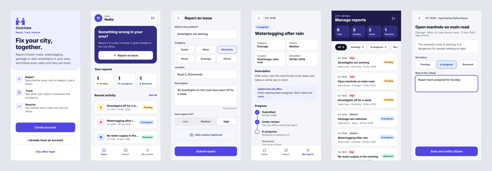

**Role:** UI/UX designer (solo) · **Platform:** mobile web · **Type:** personal portfolio project, v2 redesign
**Deliverables:** user flow, visual design system, 10-screen interactive prototype

## The problem

In many cities, complaints are still made on paper or by phone. They get lost, and the person who reported never hears back. Residents need a fast way to report and a clear view of what happens next; the city office needs one place to sort and answer reports.

## Before and after

Version 1 had the right flow but was hard to read, gave no feedback after submitting, and its categories didn't match the problems city residents actually report.

| v1 problem | v2 fix |
| --- | --- |
| Dark text on saturated purple on every screen | Light background, white cards, indigo only as an accent |
| Categories that didn't match city problems (Library, Academic, Facilities) | Categories residents actually report: Roads, Water, Electricity, Waste, Drainage |
| No confirmation after submitting | Success screen with a ticket ID |
| Only a status word, no explanation | 4-step progress timeline and a reply note from the city office |
| Cramped tables and hidden dropdowns | Report cards, tappable category chips, status filters |
| Navigation only via "Back to Dashboard"; typos like "SINGUP" | Bottom tab bar, back buttons, cleaned-up copy |

<b>See the v1 (original) design</b>

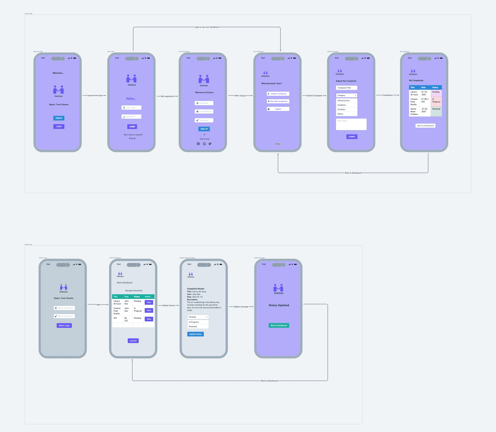

## Key design decisions

- **Report in under a minute.** Only title and description are required; category, urgency and photo are one tap each.
- **Always show where things stand.** Every report has a status pill, a ticket ID and a progress timeline.
- **Close the loop.** The city office changes status and writes a note in one step, and the citizen sees it.
- **One login, two roles.** A Citizen / City office switch replaces two near-identical login screens.
- **Accessible by default.** 44 px touch targets, 4.5:1 text contrast, status shown in words as well as colour.

## User flow

Two short flows share one report record: the citizen creates and reads it, the city office updates it.

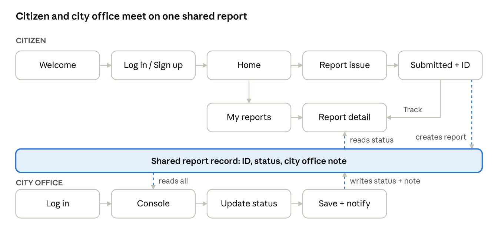

## Visual system

| | |
| --- | --- |
| Logo | Two people shaking hands, indigo #5B4FE9; tagline "Report. Track. Resolve." |
| Colours | Primary #4F46E5 · dark #312E81 · background #F5F6FA · text #111827 |
| Status | Pending amber · In progress blue · Resolved green, always with a label |
| Type | Plus Jakarta Sans, 12 to 34 px |
| Shape | 4 px spacing grid, 12 to 16 px corner radius |
| Components | Buttons, inputs, chips, segmented control, status pill, report card, timeline, tab bar, toast |

## Screens

| Welcome | Log in | Home |
| --- | --- | --- |
| 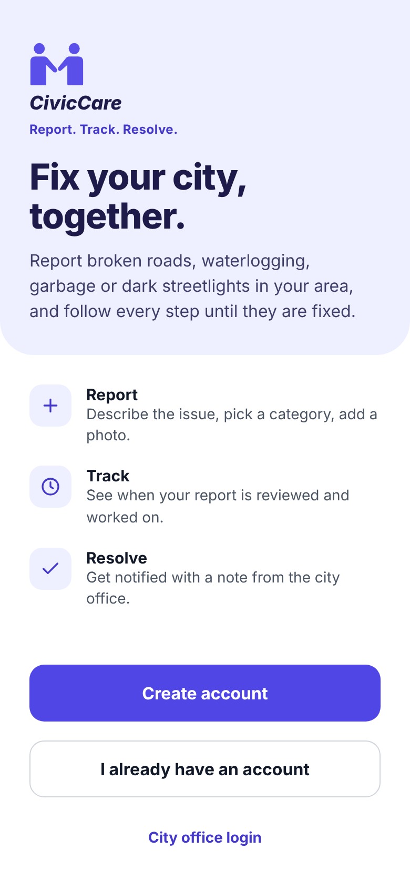 | 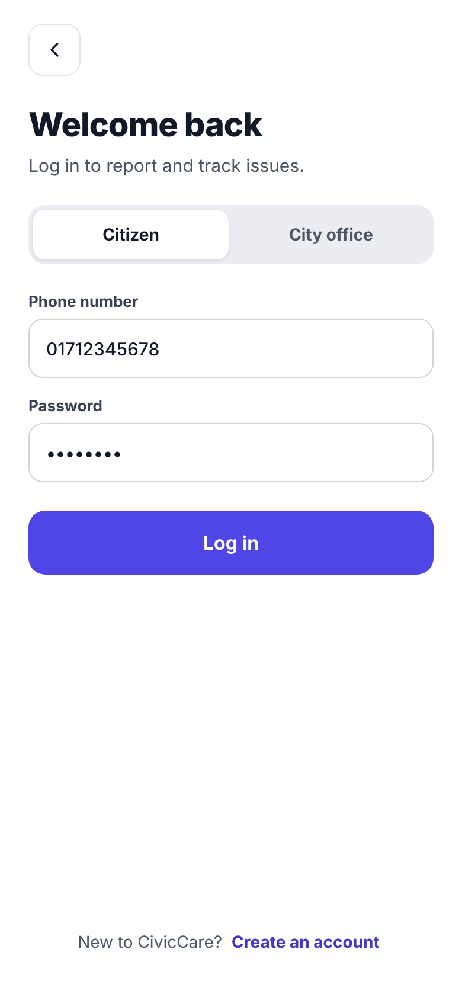 | 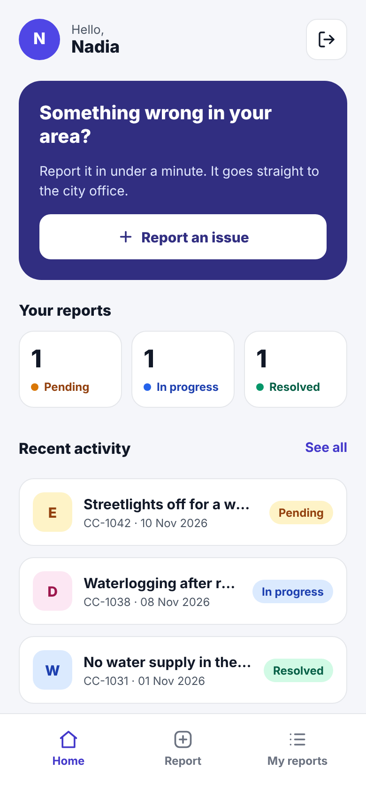 |
| **Report an issue** | **Submitted** | **My reports** |
| 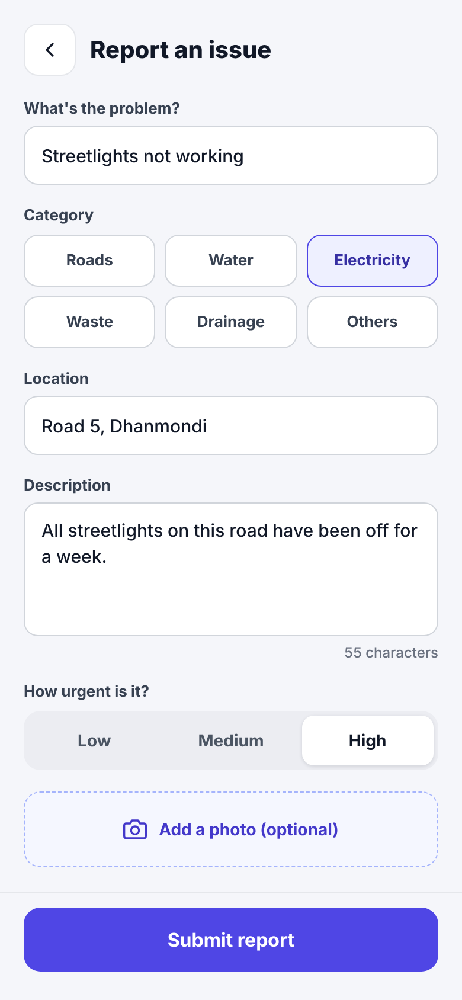 | 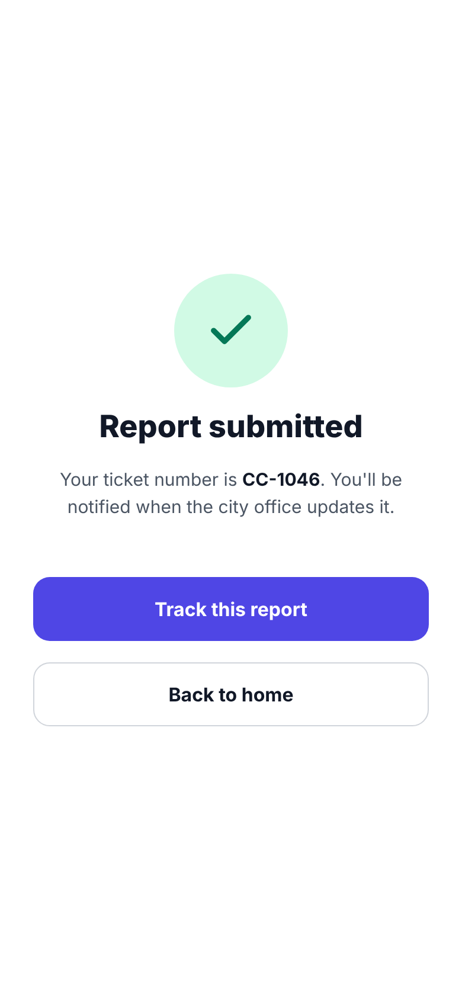 | 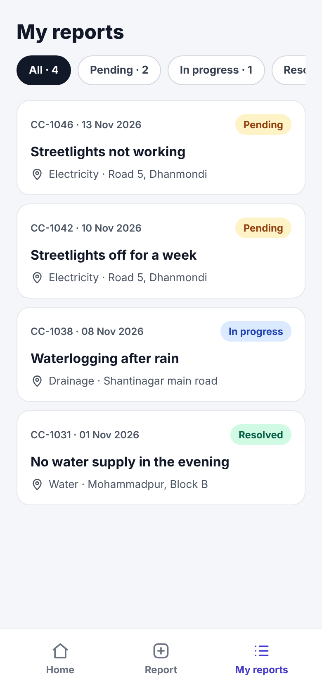 |
| **Report detail** | **City office console** | **Update status** |
| 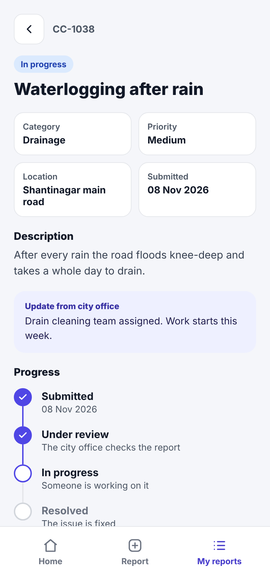 | 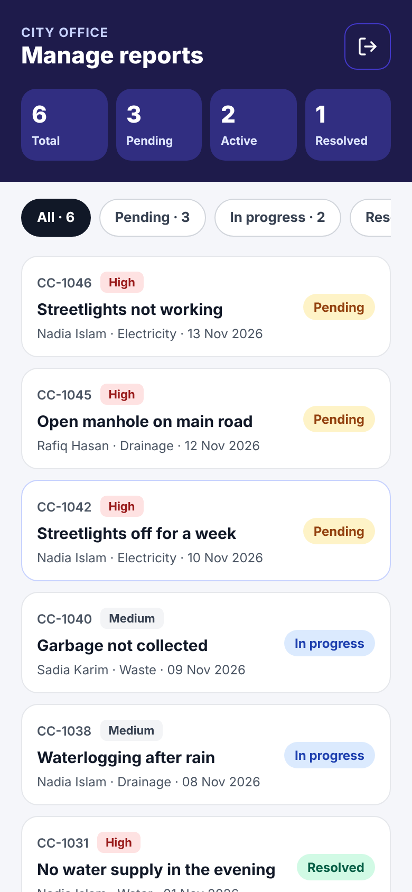 | 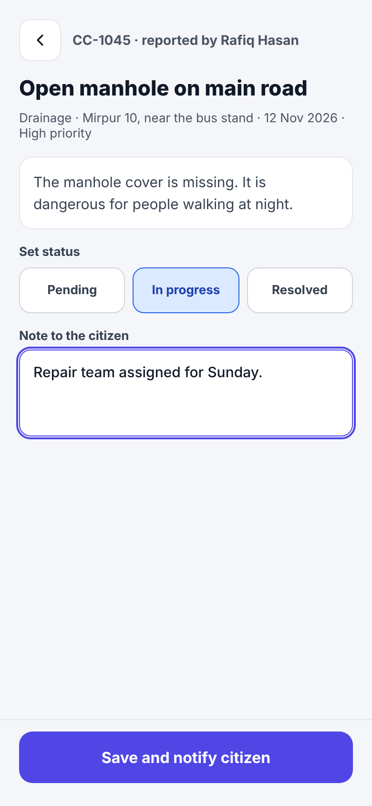 |

## Try the prototype

Open the [live prototype](https://nadvi-ekram.github.io/CivicCare/). Log in as a citizen and submit a report, then log out, switch to **City office**, change its status and add a note. Log back in as a citizen to see the update on the timeline. Data resets when the page reloads.

Each screen also has its own link: [home](https://nadvi-ekram.github.io/CivicCare/#home) · [report](https://nadvi-ekram.github.io/CivicCare/#report) · [reports](https://nadvi-ekram.github.io/CivicCare/#reports) · [detail](https://nadvi-ekram.github.io/CivicCare/#detail) · [console](https://nadvi-ekram.github.io/CivicCare/#console) · [update-status](https://nadvi-ekram.github.io/CivicCare/#update-status)

## What's next

- Build v2 in Django and test it with real residents
- Bangla language option
- Map pin for location and real photo upload
- SMS and push notifications when a status changes
- Route reports to the right department automatically
